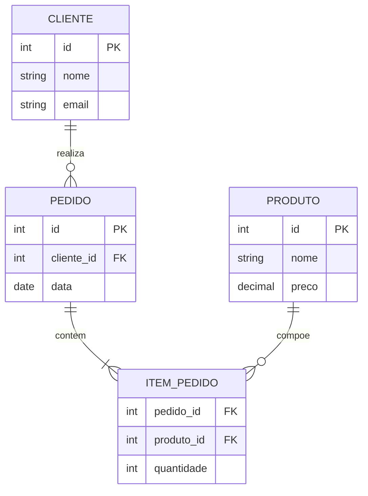

<div align="center">


<br>

[](https://github.com/diasantonio-dotcom)
<!-- Para adicionar LinkedIn, apague as setas desta linha e a da linha de baixo e troque SEU-USUARIO:
[](https://linkedin.com/in/SEU-USUARIO)
-->
<!-- Para adicionar e-mail, use esta linha:
[](mailto:SEU-EMAIL)
-->

</div>

---

## 🎯 Objetivo

Buscando **estágio ou vaga júnior** em **Banco de Dados, Análise de Dados ou Desenvolvimento Back-end**, aplicando modelagem e SQL em problemas reais.

## 👨‍💻 Sobre mim

Sou estudante de Tecnologia e gosto de ver um sistema nascer pelos dados. Meu processo é: **entender o problema → desenhar o DER → normalizar → criar o banco → escrever as consultas** que respondem às perguntas do negócio. Também construo interfaces web com HTML e CSS.

| 🗄️ Banco de Dados | 📐 Modelagem | 🌐 Web |
|:---:|:---:|:---:|
| Tabelas, chaves, restrições, `JOIN`, agregações e views | Modelo conceitual e lógico, DER e normalização | Páginas e interfaces com HTML e CSS |

## 🛠️ Tecnologias

<p align="center">
  
</p>

## 📐 Como eu modelo dados

Exemplo de DER (loja com clientes, pedidos e produtos):



## 🔍 Como eu escrevo SQL

```sql
-- Top 5 clientes por faturamento nos últimos 30 dias
SELECT c.nome,
       COUNT(DISTINCT p.id)              AS total_pedidos,
       SUM(i.quantidade * pr.preco)      AS faturamento
FROM   cliente c
JOIN   pedido p        ON p.cliente_id = c.id
JOIN   item_pedido i   ON i.pedido_id  = p.id
JOIN   produto pr      ON pr.id        = i.produto_id
WHERE  p.data >= CURRENT_DATE - INTERVAL '30 days'
GROUP  BY c.nome
ORDER  BY faturamento DESC
LIMIT  5;
```

## 📊 GitHub em números

<p align="center">
  
  
</p>

<!--
PROJETOS EM DESTAQUE: quando quiser mostrar um projeto, apague as setas deste bloco
e troque NOME-DO-REPO pelo nome exato do repositório:

## 🗂️ Projetos em destaque

<a href="https://github.com/diasantonio-dotcom/NOME-DO-REPO">
  
</a>
-->


