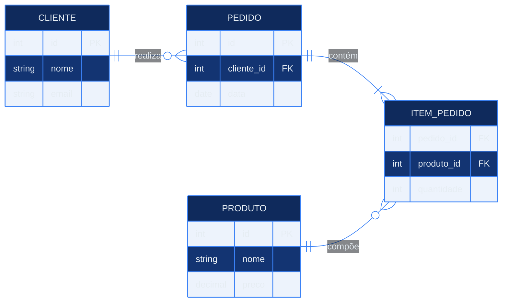

<div align="center">


<br>

[](https://github.com/diasantonio-dotcom)
<!-- Para adicionar LinkedIn, apague as setas desta linha e a da linha de baixo e troque SEU-USUARIO:
[](https://linkedin.com/in/SEU-USUARIO)
-->
<!-- Para adicionar e-mail, use esta linha:
[](mailto:SEU-EMAIL)
-->

</div>

---

## 🎯 Objetivo

Buscando **estágio ou vaga júnior** em **Banco de Dados, Análise de Dados ou Desenvolvimento Back-end**, aplicando modelagem e SQL em problemas reais.

## 👨‍💻 Sobre mim

Sou estudante de Tecnologia e gosto de ver um sistema nascer pelos dados. Meu processo é: **entender o problema → desenhar o DER → normalizar → criar o banco → escrever as consultas** que respondem às perguntas do negócio. Também construo interfaces web com HTML e CSS.

| 🗄️ Banco de Dados | 📐 Modelagem | 🌐 Web |
|:---:|:---:|:---:|
| Tabelas, chaves, restrições, `JOIN`, agregações e views | Modelo conceitual e lógico, DER e normalização | Páginas e interfaces com HTML e CSS |

## 🛠️ Tecnologias

<p align="center">
  
</p>

## 📐 Modelagem de dados

> Exemplo de DER (modelo entidade-relacionamento) de uma loja, normalizado até a 3FN.



## 🔍 Consultas SQL

> Ranking dos 5 melhores clientes dos últimos 30 dias, com participação no faturamento total.

```sql
WITH faturamento_cliente AS (
    SELECT  c.id,
            c.nome,
            COUNT(DISTINCT p.id)          AS total_pedidos,
            SUM(i.quantidade * pr.preco)  AS faturamento
    FROM        cliente     c
    INNER JOIN  pedido      p  ON p.cliente_id = c.id
    INNER JOIN  item_pedido i  ON i.pedido_id  = p.id
    INNER JOIN  produto     pr ON pr.id        = i.produto_id
    WHERE   p.data >= CURRENT_DATE - INTERVAL '30 days'
    GROUP BY c.id, c.nome
)
SELECT  RANK() OVER (ORDER BY faturamento DESC)               AS posicao,
        nome,
        total_pedidos,
        ROUND(faturamento, 2)                                 AS faturamento,
        ROUND(100 * faturamento / SUM(faturamento) OVER (), 1) AS pct_do_total
FROM    faturamento_cliente
ORDER BY posicao
LIMIT 5;
```

**Resultado** (dados fictícios):

| posição | nome | total_pedidos | faturamento | pct_do_total |
|:---:|---|:---:|---:|:---:|
| 1 | Maria Souza | 12 | 4.820,00 | 23,4 |
| 2 | João Lima | 9 | 3.150,50 | 15,3 |
| 3 | Ana Costa | 7 | 2.740,00 | 13,3 |
| 4 | Pedro Alves | 5 | 1.980,90 | 9,6 |
| 5 | Carla Dias | 4 | 1.455,00 | 7,1 |

<details>
<summary><b>O que essa consulta usa</b></summary>

- **CTE (`WITH`)** para organizar a consulta em etapas
- **`JOIN` entre 4 tabelas** seguindo o modelo acima
- **Agregações** com `COUNT`, `SUM` e `GROUP BY`
- **Funções de janela** com `RANK()` e `SUM() OVER ()`
- **Filtro por período** com `CURRENT_DATE` e `INTERVAL`

</details>

## 📊 GitHub em números

<p align="center">
  
  
</p>

<!--
PROJETOS EM DESTAQUE: quando quiser mostrar um projeto, apague as setas deste bloco
e troque NOME-DO-REPO pelo nome exato do repositório:

## 🗂️ Projetos em destaque

<a href="https://github.com/diasantonio-dotcom/NOME-DO-REPO">
  
</a>
-->


