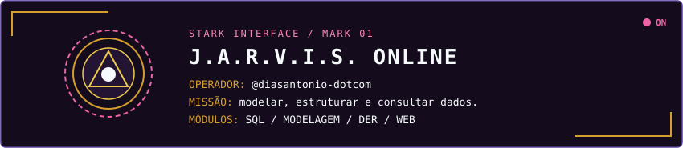
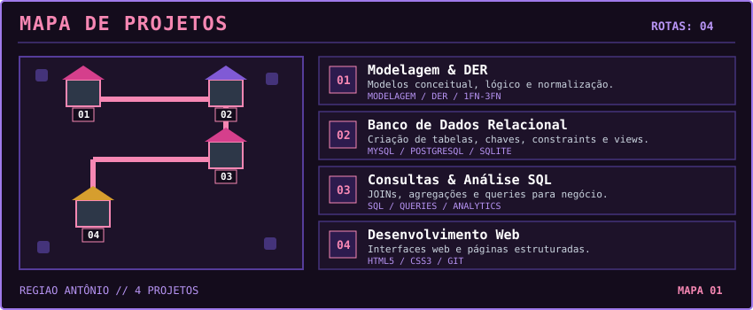

<!-- 1. JANELA RETRÔ + GIF DO GATO DIGITANDO NO COMPUTADOR + BOTÃO DE MÚSICA -->

  
  
    
  

 

<!-- 2. TERMINAL JARVIS.EXE -->

  

 

<!-- 3. TRAINER CARD PIXEL ART -->

  

 

<!-- 4. PAINEL STARK INTERFACE / REATOR ARC -->

  

 

<!-- 5. ARSENAL TECNOLÓGICO EM GRADE 2x2 -->
<h3 align="center">⚙️ Arsenal Tecnológico</h3>

| Banco de Dados & SQL | Front-end |
| :---: | :---: |
|  |  |

| Modelagem & Dados | Ferramentas |
| :---: | :---: |
|  |  |

 

<!-- 6. MAPA DE PROJETOS PIXEL ART + LINKS + BOTÕES -->

  
    
  <a href="https://github.com/diasantonio-dotcom?tab=repositories">Modelagem & DER</a> • <a href="https://github.com/diasantonio-dotcom?tab=repositories">Banco de Dados</a> • <a href="https://github.com/diasantonio-dotcom?tab=repositories">Consultas SQL</a> • <a href="https://github.com/diasantonio-dotcom?tab=repositories">Web</a>
    
  
  

 

<!-- 7. CENTRAL DE MONITORAMENTO JARVIS -->
<h3 align="center">📡 Central de Monitoramento JARVIS</h3>

  
  

 

  

 

  

---

<!-- 8. CITAÇÃO FINAL -->

  <i>"Sem dados, você é apenas mais uma pessoa com uma opinião."</i> 
  — W. Edwards Deming

