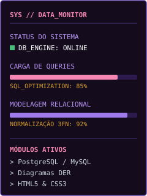
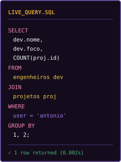
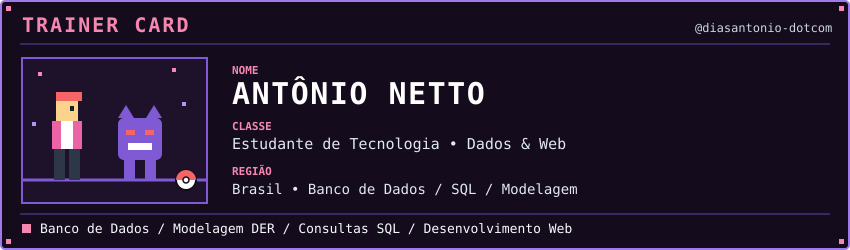
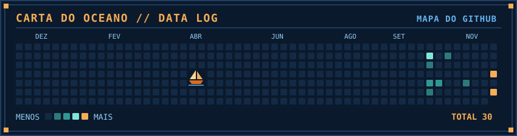

<!-- 1. JANELA RETRÔ + TELEMETRIA LATERAL + GATO + MÚSICA -->

  
  
  <table width="100%">
    <tr>
      <td align="center" width="28%" bgcolor="#140C1C">
        
      </td>
      <td align="center" width="44%" bgcolor="#140C1C">
        
      </td>
      <td align="center" width="28%" bgcolor="#140C1C">
        
      </td>
    </tr>
  </table>

  

 

<!-- 2. IDENTIFICAÇÃO PRINCIPAL (TRAINER CARD) -->

  

 

<!-- 3. ARSENAL TECNOLÓGICO COMPLETO E PADRONIZADO -->
<h3 align="center">⚙️ Arsenal Tecnológico</h3>

| Linguagens & Back-end | Banco de Dados & SQL | Front-end | Ferramentas & Ambiente |
| :---: | :---: | :---: | :---: |
|  |  |  |  |

 

<!-- 4. MAPA DE PROJETOS PIXEL ART -->

  
   
  
  

 

<!-- 5. CENTRAL DE MONITORAMENTO (3 CARDS EM UMA ÚNICA FILEIRA) -->
<h3 align="center">📡 Central de Monitoramento JARVIS</h3>

  
  
  

 

<!-- 6. CARTA DO OCEANO / MAPA DE CONTRIBUIÇÕES -->

  

---

  <i>"Sem dados, você é apenas mais uma pessoa com uma opinião."</i> — <b>W. Edwards Deming</b>

