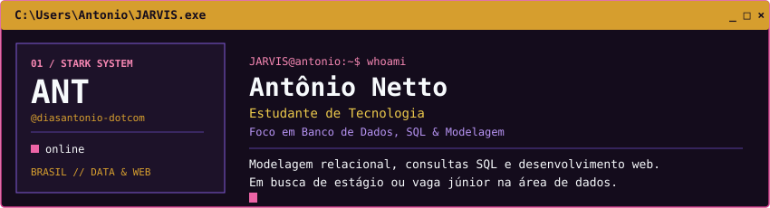
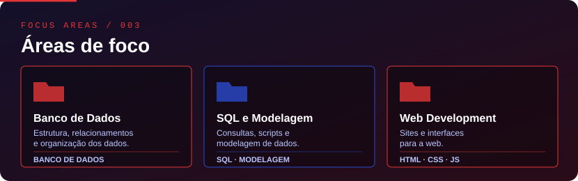

  
    
  

 

  

 

  

 

<h3 align="center">⚙️ Arsenal tecnológico</h3>

| Programação & SQL | Front-end |
| :---: | :---: |
|  |  |

| Banco de dados | Ferramentas |
| :---: | :---: |
|  |  |

 

  
    
  <a href="https://github.com/diasantonio-dotcom?tab=repositories">Repositórios</a> • <a href="https://github.com/diasantonio-dotcom">Perfil</a>
    
  
  

 

<h3 align="center">📡 Central de Monitoramento JARVIS</h3>

  
  

 

  

 

  

